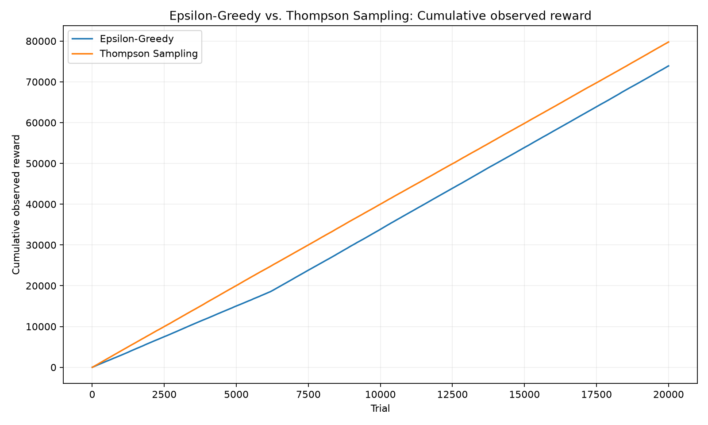
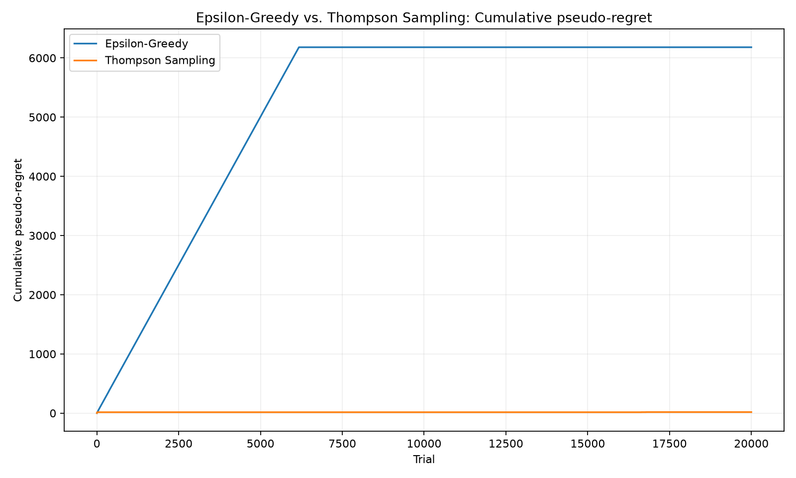
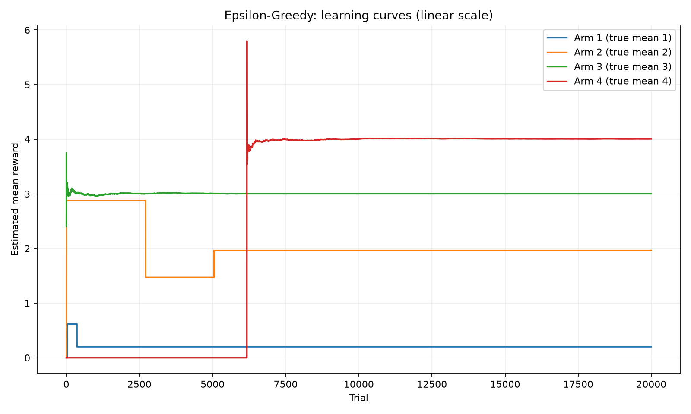
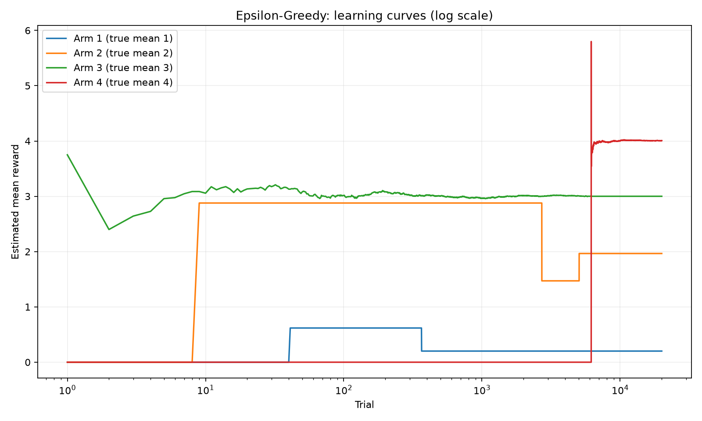
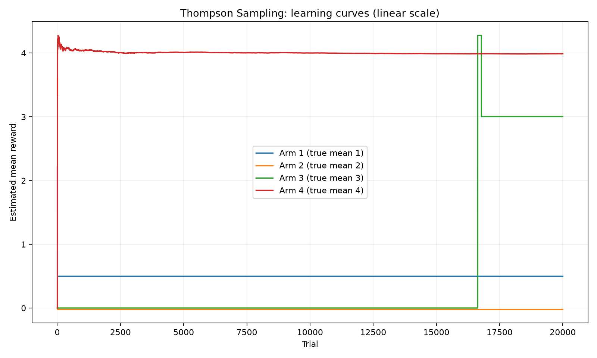
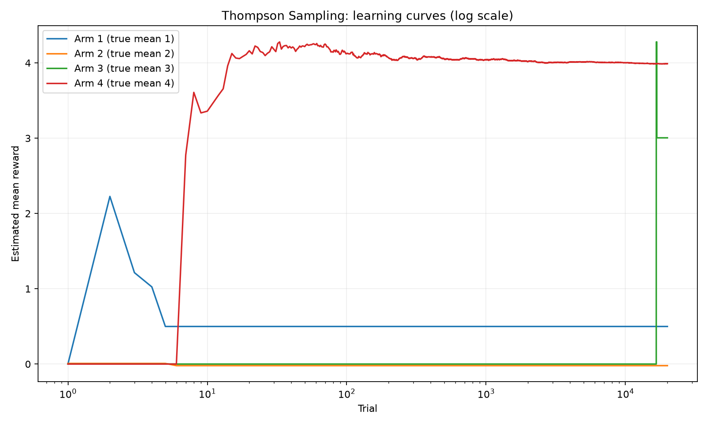

# Homework 2 — A/B Testing with Multi-Armed Bandits

This repository compares **decaying Epsilon-Greedy** and **Gaussian Thompson Sampling with known precision** for four advertising options, using 20,000 trials per algorithm.

## Assignment checklist

- [x] Keep every original abstract method in `Bandit` (`__init__`, `__repr__`, `pull`, `update`, `experiment`, `report`).
- [x] Implement `EpsilonGreedy(Bandit)` and `ThompsonSampling(Bandit)` (via a shared subclass of `Bandit`).
- [x] Use Epsilon-Greedy exploration probability `epsilon(t) = 1/t`.
- [x] Use Gaussian Thompson Sampling with known observation precision.
- [x] Visualize bandit learning on linear and logarithmic trial scales (`plot1`).
- [x] Compare cumulative rewards and regrets (`plot2`).
- [x] Save `{Bandit, Reward, Algorithm}` and extra columns to CSV.
- [x] Report total/average reward and cumulative/average regret.
- [x] Use logging instead of `print`.
- [x] Include recommendations for an improved experiment (bonus section below).

## Experimental setup

| Setting | Value |
|---|---|
| Bandit true mean rewards | `[1, 2, 3, 4]` |
| Trials | 20,000 **per algorithm** |
| Reward distribution | Gaussian `N(mu_arm, 1)` |
| Known observation precision `tau` | `1.0` |
| Epsilon-Greedy | `epsilon_t = min(1, 1/t)` |
| Thompson Sampling prior for each arm's unknown mean | `N(0, 1)` |
| Thompson Sampling observation precision | `1.0` |
| Random seeds | 42 (Epsilon-Greedy), 43 (Thompson Sampling) |
| Optimal arm | Bandit 4, expected reward 4 |

The lecture notebook includes Gaussian-arm experiments and a normal-normal posterior update, which this implementation follows. Four mean rewards `[1, 2, 3, 4]` are taken directly from the assignment. **These values are mean rewards, not Bernoulli probabilities.**

## Algorithm explanation

### 1. Epsilon-Greedy

At trial `t = 1, ..., 20000`:
1. Set `epsilon_t = 1/t`.
2. With probability `epsilon_t`, select a random arm (explore).
3. Otherwise, select the arm with the highest estimated sample mean (exploit). Ties are broken randomly.
4. Draw a reward from the arm, then update its mean online:

   `estimate_new = estimate_old + (reward - estimate_old) / number_of_pulls`

**Caution:** `1/t` is a strict and very fast decay. It can trap the policy on a suboptimal arm after a few unlucky early trials. We retain it because the homework explicitly requires it.

### 2. Thompson Sampling, known precision

For each arm `i`, model its unknown mean reward as a Normal distribution:

- Prior: `mu_i ~ N(m_i, 1/lambda_i)` with `m_i = 0`, `lambda_i = 1` initially.
- Observed reward: `x ~ N(mu_i, 1/tau)` with **known** `tau = 1`.

At each trial:
1. Independently draw one sample `theta_i ~ N(m_i, 1/lambda_i)` per arm.
2. Select the arm with the highest sampled `theta_i`.
3. Observe reward `x` and update the selected arm's posterior:

   `lambda_new = lambda_old + tau`

   `m_new = (lambda_old * m_old + tau * x) / lambda_new`

These are the conjugate Gaussian posterior formulas used in the provided reference notebook.

### 3. Regret definition

The assignment asks for cumulative regret. Here we report **expected (pseudo-)regret** for the selected arms:

`regret_t = max(true_mean_rewards) - true_mean_reward_of_selected_arm`

`cumulative_regret_T = sum(regret_t for t = 1..T)`

Pseudo-regret measures decision quality regardless of observation noise. The realized reward and expected regret can therefore vary independently.

## How to run locally

You need Python 3.9+ and a working terminal.

```bash
python -m pip install -r requirements.txt
python Bandit.py
```

On some Macs, use `python3` instead of `python` in both commands.

The run recreates the CSV files and all six plots. To run the built-in tests:

```bash
python -m unittest discover -s tests -v
```

## Results: one reproducible run

| Metric | Epsilon-Greedy | Thompson Sampling |
|---|---:|---:|
| Total observed reward | 73,907.23 | 79,766.83 |
| Average observed reward | 3.6954 | 3.9883 |
| Cumulative pseudo-regret | 6,181.00 | 18.00 |
| Average pseudo-regret | 0.3090 | 0.0009 |
| Optimal arm chosen | 69.13% | 99.96% |
| Pulls of arms 1, 2, 3, 4 | 2, 3, 6169, 13826 | 4, 2, 2, 19992 |

For seeds 42/43, **Thompson Sampling performed better** in total reward and pseudo-regret. Results depend on random draws: a single run does **not** establish that one policy is uniformly better for every seed or problem setting. The Epsilon-Greedy result illustrates the risk of overly rapid exploration decay.

## Visualizations

### Cumulative rewards


### Cumulative pseudo-regret


### Learning process: estimated means





## Bonus: better implementation/experiment plan

This submission already adds reproducible per-policy generators, stable posterior updates, CSV exports, logging, test coverage, and both linear/log plots. For a **stronger scientific comparison**, the following extension is recommended (not implemented in the main single-run assignment):

1. Repeat each algorithm for **100 or more independent seeds** and report mean cumulative regret with confidence intervals. A single random run can be misleading.
2. Evaluate additional exploration schedules, e.g. `min(1, c/t)` and `min(1, c/sqrt(t))`. Keep `1/t` as the main homework baseline.
3. Use a shared pre-generated *potential rewards* table indexed by `(trial, arm)` for paired comparisons, so both strategies face the same arm noise when selecting the same arm at the same trial.
4. Add more settings with close arm means, different Gaussian noise levels, and nonstationary means to test robustness.
5. Monitor how often each algorithm picks the optimal arm, its cumulative regret, and whether confidence intervals overlap across seeds.
6. For production ad selection, consider real conversion/revenue distributions, delayed feedback, business constraints, and policy evaluation before deployment.
